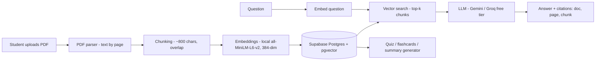

# StudyMind AI

A RAG-based AI study assistant for students. Upload your lecture PDFs and notes into a subject workspace, ask questions, and get answers **with citations to the exact page and chunk** the answer came from — plus auto-generated quizzes, flashcards, and summaries built only from your own material.

Built by **Vegulla Virendra Kaushik** — BTech CSE (AI & ML), Semester 3, Centurion University (CUTM), Bhubaneswar. StudyMind grew out of revising for his own Semester 3 exams (Probability Statistics, Cloud Practitioner AWS, Data Structures, Relational and Distributed Databases).

> **Platform:** StudyMind AI is a **website**, not a native app. Students use it on a laptop with their PDFs open beside it, and a live link is what GitHub reviewers, internship panels, and judges can actually open. A PWA install option may be added later from this same codebase.

## Why this project

- **RailX** covers Android/product engineering and **ShieldNet** covers classical ML + cybersecurity. StudyMind is the GenAI / LLM piece: retrieval-augmented generation, embeddings, and vector search.
- Most "chat with your PDF" demos hallucinate. StudyMind's rule is simple: **no citation, no answer.** If the uploaded material does not contain the answer, it says so.

## Features (MVP)

- Subject workspaces (e.g. Data Structures, Databases, Cloud) to organise material
- Upload lecture PDFs / notes into a workspace
- Ask questions and get answers with citations — document name, page number, and the chunk used
- Generate quizzes, flashcards, and summaries from the uploaded material only
- Web app: FastAPI backend + React frontend

## Architecture



## Tech stack

| Layer | Choice | Why |
|---|---|---|
| Backend | FastAPI (Python) | Same stack as ShieldNet, async, auto docs |
| Frontend | React + Vite | Same stack as ShieldNet dashboard |
| Database / vectors | Supabase Postgres + pgvector | Already used on RailX; one DB for data + embeddings |
| Embeddings | `all-MiniLM-L6-v2` (local, free) | No API key, 384-dim, runs on CPU |
| LLM | Gemini or Groq free tier (pluggable) | Free tier is enough for study Q&A and generation |
| Deploy (planned) | Render (backend) + Vercel (frontend) | Same pattern as ShieldNet |

## Project structure

```
studymind-ai/
  backend/          FastAPI app: routers, RAG services, tests
  frontend/         React + Vite web app
  supabase/         pgvector schema (workspaces, documents, chunks, messages)
  docs/             Architecture and demo notes
```

## Run it locally

Backend:

```bash
cd backend
python -m venv .venv && source .venv/bin/activate
pip install -r requirements.txt
uvicorn app.main:app --reload --port 8000
# health check: http://localhost:8000/health
```

Frontend:

```bash
cd frontend
npm install
npm run dev
# app: http://localhost:5173 (proxies /api to the backend)
```

Copy `.env.example` to `.env`. The app runs without any keys: with no `DATABASE_URL` it uses the in-memory repository, and the LLM layer reports itself as not configured instead of faking answers. To use real persistence, set `DATABASE_URL` to a Supabase Postgres connection string — the backend applies `supabase/schema.sql` itself on first run and switches to pgvector storage and search. No code change.

## Current status

Working: repository structure, FastAPI backend with `/health` (reports persistence backend, embeddings, and LLM state), workspace CRUD, PDF upload with per-page parsing and chunking, a retrieval-and-citation chat endpoint, and generation endpoints (summary / flashcards / quiz in extractive scaffold mode), plus a React shell with subject sidebar, upload, and chat panels.

Persistence: a repository layer with two interchangeable backends — in-memory for zero-setup local runs, and Postgres + pgvector for Supabase. Chunks are embedded at ingest when the local model is installed; questions are searched by cosine similarity (`<=>`), with a labelled keyword fallback. The pgvector search was verified on Supabase Postgres 17 with 384-dim vectors (near match similarity 0.994 vs 0.110 unrelated). Backend tests: 11 passing, 1 Postgres round-trip test that runs when `TEST_DATABASE_URL` is set.

Still scaffold-mode: answers are extractive (they quote your notes) until an LLM key is configured. No evaluation numbers are published yet — accuracy / retrieval metrics will be added only when they have actually been measured on real notes.

## Roadmap

- Create the StudyMind Supabase project and point `DATABASE_URL` at it
- Connect Gemini / Groq for fluent answers, quiz, flashcard, and summary generation
- Auth (Supabase Auth), then deploy: Render backend + Vercel frontend
- Optional later: PWA installability from the same website codebase

## License

MIT — see `LICENSE`.
