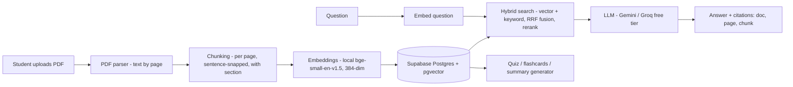

# StudyMind AI

A RAG-based AI study assistant for students. Upload your lecture PDFs and notes into a subject workspace, ask questions, and get answers **with citations to the exact page and chunk** the answer came from — plus auto-generated quizzes, flashcards, and summaries built only from your own material.

Built by **Vegulla Virendra Kaushik** — BTech CSE (AI & ML), Semester 3, Centurion University (CUTM), Bhubaneswar. StudyMind grew out of revising for his own Semester 3 exams (Probability Statistics, Cloud Practitioner AWS, Data Structures, Relational and Distributed Databases).

> **Platform:** StudyMind AI is a **website**, not a native app. Students use it on a laptop with their PDFs open beside it, and a live link is what GitHub reviewers, internship panels, and judges can actually open. A PWA install option may be added later from this same codebase.

## Live demo

- **App:** https://studymind-ai-two.vercel.app
- **API:** https://studymind-backend-9acr.onrender.com (health at `/health`)

Deployed 18 Nov 2026 - Render free backend + Vercel frontend, CORS wired, seeded workspaces visible on the live page. The hosted backend runs on Supabase Postgres (uploads persist) with Gemini answers and a Groq fallback. Hosted embeddings run through the ONNX fastembed runtime in `requirements.txt`; `/health` names the active embedder honestly (`fastembed`, `sentence-transformers`, or `not_installed` for keyword-only retrieval). The free Render service sleeps when idle, so the first request after a break can take about a minute.

## Why this project

- **RailX** covers Android/product engineering and **ShieldNet** covers classical ML + cybersecurity. StudyMind is the GenAI / LLM piece: retrieval-augmented generation, embeddings, and vector search.
- Most "chat with your PDF" demos hallucinate. StudyMind's rule is simple: **no citation, no answer.** If the uploaded material does not contain the answer, it says so.

## Features

- Subject workspaces (e.g. Data Structures, Databases, Cloud) to organise material
- Upload lecture PDFs / notes into a workspace — validated (size cap, PDF magic bytes), with scanned-image pages detected and reported instead of silently producing nothing
- Ask questions and get answers with citations — document name, page number, and the chunk used
- Parent-child retrieval: small child chunks are matched for precision, the parent chunk gives the answer its context, citations still name the child's page
- Optional HyDE search (off by default): a hypothetical answer is embedded instead of the raw question
- Generate quizzes (validated: 4 distinct options, one correct, grounded), flashcards, and summaries from the uploaded material only — generated once and cached, not re-billed per click
- Flashcards with spaced repetition: FSRS scheduling by default (SM-2 available via `SRS_ENGINE=sm2`), with a due-cards review queue
- Answer styles: concise / standard / exam
- LLM quota armour: retry with backoff, per-provider cooldown, Gemini → Groq → labelled extractive fallback
- Security headers and per-IP rate limiting on the chat/generate endpoints (see `docs/SECURITY.md` — including what is *not* in place yet: no user auth)
- Web app: FastAPI backend + React frontend

## Architecture



## Tech stack

| Layer | Choice | Why |
|---|---|---|
| Backend | FastAPI (Python) | Same stack as ShieldNet, async, auto docs |
| Frontend | React + Vite | Same stack as ShieldNet dashboard |
| Database / vectors | Supabase Postgres + pgvector | Already used on RailX; one DB for data + embeddings |
| Embeddings | `BAAI/bge-small-en-v1.5` via fastembed (ONNX, local, free) | No API key, 384-dim, runs on CPU, far stronger retrieval than MiniLM — and no torch, so it fits a free-tier service. sentence-transformers is supported as an optional heavier runtime |
| LLM | Gemini or Groq free tier (pluggable) | Free tier is enough for study Q&A and generation |
| Deploy (planned) | Render (backend) + Vercel (frontend) | Same pattern as ShieldNet |

## Project structure

```
studymind-ai/
  backend/          FastAPI app: routers, RAG services, tests
  frontend/         React + Vite web app
  supabase/         pgvector schema (workspaces, documents, chunks, messages)
  docs/             Architecture and demo notes
```

## Run it locally

Backend:

```bash
cd backend
python -m venv .venv && source .venv/bin/activate
pip install -r requirements.txt
uvicorn app.main:app --reload --port 8000
# health check: http://localhost:8000/health
```

Frontend:

```bash
cd frontend
npm install
npm run dev
# app: http://localhost:5173 (proxies /api to the backend)
```

Copy `.env.example` to `.env`. The app runs without any keys: with no `DATABASE_URL` it uses the in-memory repository, and the LLM layer reports itself as not configured instead of faking answers. To use real persistence, set `DATABASE_URL` to a Supabase Postgres connection string — the backend applies `supabase/schema.sql` itself on first run and switches to pgvector storage and search. No code change.

## Current status

Working: repository structure, FastAPI backend with `/health` (reports persistence backend, embeddings, and LLM state), workspace CRUD, PDF upload with per-page parsing and chunking, a retrieval-and-citation chat endpoint, and generation endpoints (summary / flashcards / quiz in extractive scaffold mode), plus a React shell with subject sidebar, upload, and chat panels.

Persistence: a repository layer with two interchangeable backends — in-memory for zero-setup local runs, and Postgres + pgvector for Supabase. Chunks are embedded at ingest when a local embeddings runtime is installed, with a `Subject > Document > Section` context path prepended to the embedded text. Questions are answered by hybrid search: vector similarity (`<=>`) and keyword ranking (Postgres `tsvector` / in-memory overlap) fused with Reciprocal Rank Fusion, an optional local FlashRank rerank, and a refusal threshold — weak matches are refused with no LLM call instead of being answered from unrelated notes. Retrieval matches small child chunks and answers from the parent chunk's full text (parent-child retrieval, `PARENT_CHILD_RETRIEVAL=off` restores parent-only search). Citations are labelled `[S1]`, `[S2]` by the server, never by the model. The pgvector search was verified on Supabase Postgres 17 with 384-dim vectors (near match similarity 0.994 vs 0.110 unrelated). Backend tests: 78 passing, 1 Postgres round-trip test that runs when `TEST_DATABASE_URL` is set (skipped without it).

LLM layer: Gemini and Groq providers are implemented (plain HTTPS, no SDK, env-swappable) for cited answers and for summary / flashcard / quiz generation, with strict JSON parsing for the generated items and an automatic fallback to the labelled extractive mode if the provider fails or its output does not parse. Provider calls retry with exponential backoff on 429/5xx/timeouts, a provider that keeps failing enters a cooldown and is skipped, and generation falls through Gemini → Groq → extractive in that order. Covered by mock-transport tests with injected clocks, so the suite never actually sleeps.

Retrieval evaluation: `backend/eval/` runs a 20-question golden set over sample lecture fixtures through the real pipeline and reports Recall@5, citation correctness, and two offline proxy metrics (context precision, citation coverage — document-identity checks, explicitly *not* RAGAS). Fixture numbers are pipeline sanity checks, not accuracy on real notes.

Verified live on 18 Nov 2026 with a free-tier Gemini key (default model `gemini-3.5-flash`, with `gemini-3.8-flash` and `gemini-flash-latest` as fallbacks): uploading the B-tree test PDF and asking about it returned a Gemini answer in `llm` mode with inline citations like `[dsa-notes.pdf p.1]`, and summary, flashcards, and a 4-option MCQ quiz all returned in `llm` mode. Two honest caveats from that session: older models (`gemini-2.0-flash`, `gemini-2.5-flash`) return 404 for newly created keys, so the defaults target current models; and Gemini's free tier intermittently returns 503 under load — during one spike the chat endpoint fell back to extractive mode exactly as designed, then returned to `llm` mode on the next run.

No accuracy numbers on real student notes are published yet — the eval harness numbers in `backend/eval/results.json` are fixture-based and labelled as such, and real-notes metrics will be added only when they have actually been measured.

## Roadmap

- Auth (Supabase Auth): sign-in and private workspaces — until then the app is single-user/demo (see `docs/SECURITY.md`)
- OCR for scanned pages (currently detected and reported, not processed)
- Optional later: PWA installability from the same website codebase

## License

MIT — see `LICENSE`.
